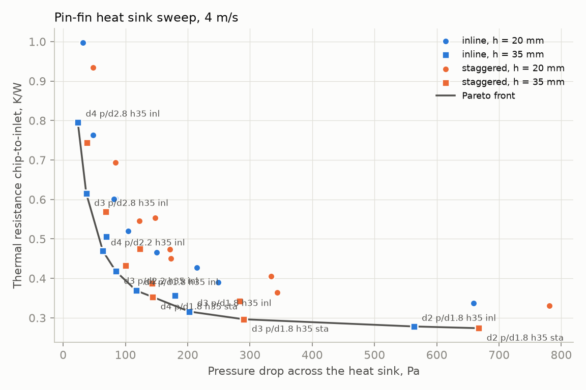
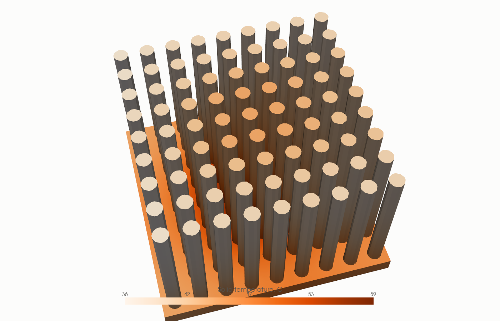
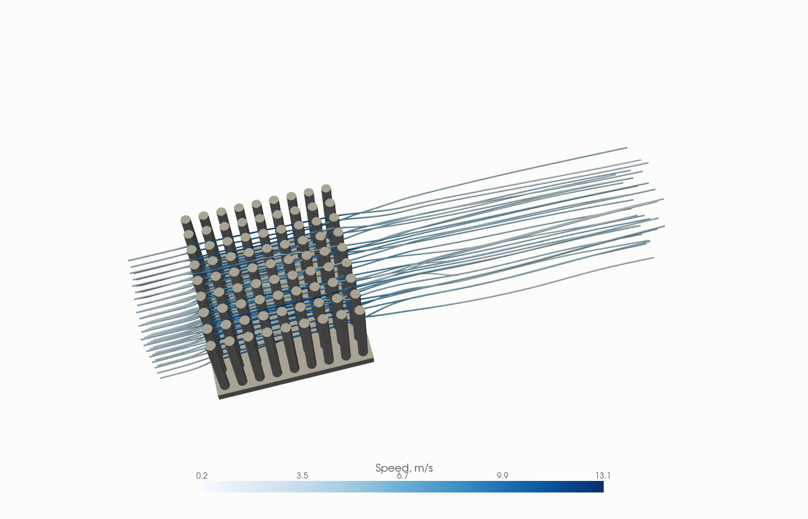

# Pin-fin heat sink optimisation: CAD, OpenFOAM CFD and a GPU surrogate

Design study of an air-cooled pin-fin heat sink for a 100 W, 30 x 30 mm chip. A parametric CadQuery
model feeds a conjugate-heat-transfer CFD workflow in OpenFOAM 14; 36 designs were simulated at 4 m/s
(plus 20 runs at 2 and 6 m/s), compared with hand calculations, ranked on a Pareto front, and used
to train a PyTorch surrogate that finds the lowest-resistance design under a pressure-drop budget.



*Thermal resistance against pressure drop for the 36 designs at 4 m/s (coarse mesh). The star is the
surrogate model's optimum, confirmed with its own CFD run.*

## Headline results

| Result | Value |
|---|---|
| Designs simulated | 36 at 4 m/s, 20 more at 2 and 6 m/s (all converged in temperature) |
| Thermal resistance range | 0.274 to 0.997 K/W (chip 52 to 125 C at 100 W, 25 C air) |
| Best thermal design | d = 2 mm, p/d = 1.8, h = 35 mm, staggered: 0.274 K/W at 667 Pa |
| Lowest pressure drop | d = 4 mm, p/d = 2.8, h = 35 mm, inline: 24 Pa at 0.796 K/W |
| Surrogate-found design (150 Pa budget) | d = 3.7 mm, p/d = 1.8, h = 35 mm, inline: 0.340 K/W at 153 Pa (CFD) |
| Pin fins vs plate fins, equal fin mass (73.6 g) | 0.274 K/W vs 0.379 K/W (28 % lower), but 667 Pa vs 29 Pa |
| CFD vs hand calculation (centre design, 2/4/6 m/s) | R within 5 %, dP within 19 % |
| Surrogate (56 CFD cases, 5-fold CV) | R^2 0.996 for R, 0.992 for dP; optimum verified by CFD to 0.3 % in R, 7 % in dP |

## Renders

Surrogate-optimum design (d = 3.7 mm, p/d = 1.8, h = 35 mm, inline), 4 m/s, coarse mesh:

| Solid temperature | Streamlines |
|---|---|
|  |  |

More renders (temperature and pressure mid-planes, speed slice, mesh close-up; also the lowest-R and
highest-R designs) are in `figures/renders/`.

## What is and is not established

- **Mesh independence is not demonstrated.** For the centre design, coarse to medium changes R by 3.7 % and
  dP by 25 %; the fine mesh (7.6 M fluid cells) could not be meshed on this laptop. Three more designs re-run on
  the medium mesh moved dP by -4 to -24 % and R by -1 to -11 % (the sparsest array moved most in R), so the
  coarse sweep's trends are supported but its absolute values are +/- 30 %. See `docs/mesh_study.md`.
- The sweep ran on the coarse mesh with 600 iterations per case; 13 of the 36 4 m/s cases still have
  a pressure residual above 1e-3 (temperature is converged in all).
- On the stitched pin/base interface the omega wall function diverged, so that patch uses a zero-gradient
  omega (`DECISIONS.md` D9).
- The surrogate's first attempt failed its CFD check (dP 26 % off) because the pin count jumps in
  integers; the geometry-aware retrain passed. Both are documented in `docs/surrogate.md`.
- No physical measurements: validation is against correlations only.

## Method

1. `src/geometry.py` builds any design as a CadQuery solid and exports STEP and STL.
2. `src/analytic.py` predicts R and dP from the ESDU 73031 and Gaddis-Gnielinski tube-bank
   correlations, pin-fin efficiency, a heat-exchanger (NTU) treatment of the array and the
   Lee et al. spreading-resistance model.
3. `src/make_case.py` writes a complete OpenFOAM 14 case: fluid and solid meshed separately
   (snappyHexMesh with prism layers), coupled with non-conformal couples in `foamMultiRun`,
   k-omega SST, steady state.
4. `src/sweep.py` runs the design matrix one case at a time and `src/results.py` parses each case;
   `src/analysis.py` produces the Pareto front and figures.
5. `src/surrogate.py` trains an MLP (PyTorch, CUDA) with 5-fold CV and searches a buildable grid for
   the lowest R under a pressure-drop budget; `src/studies.py custom` verifies the optimum with CFD.
6. `src/visuals.py` renders temperature, speed, pressure and streamlines headlessly.

Full write-up: `docs/report.md`. Other documents: `docs/mesh_study.md`, `docs/validation.md`,
`docs/results.md`, `docs/surrogate.md`.

## Problem set-up

| Item | Value |
|---|---|
| Chip | 30 x 30 mm, 100 W uniform heat flux on the underside of the base |
| Base plate | 60 x 60 x 4 mm aluminium (k = 200 W/m-K) |
| Pins | diameter 2-4 mm, pitch/diameter 1.8-2.8, height 20 or 35 mm, inline or staggered |
| Air | 25 C inlet, duct 60 mm wide, shroud touching the pin tips, 2 / 4 / 6 m/s |
| Outputs | thermal resistance R = (T_chip,max - T_in) / 100 W, pressure drop inlet-outlet, fin mass |

## How to run

Requires Linux or WSL with OpenFOAM 14 (CFD steps only); CAD, hand calculation, analysis and
surrogate run with plain Python 3.

```bash
source /opt/openfoam14/etc/bashrc     # CFD steps only
make venv && make test                # unit tests (geometry, correlations)
make quick                            # tests + CAD + hand calculation + one coarse CFD case (~5 min)
make sweep                            # the 36-case sweep at 4 m/s (about 4 hours)
make analysis                         # Pareto front, figures, docs/results.md
make surrogate                        # train the surrogate and search the design space
```

## Repository

```
src/        geometry, analytic model, case generator, sweep, results, analysis, surrogate, visuals
tests/      pytest acceptance tests for geometry and correlations
docs/       report, mesh study, validation, results, surrogate, audit
results/    sweep.csv (56 cases), pareto.csv, surrogate.json, per-study folders (T3-T9)
figures/    plots and renders
PLAN.md     task list with acceptance criteria; PROGRESS.md status; DECISIONS.md judgment calls
```

MIT licence.
